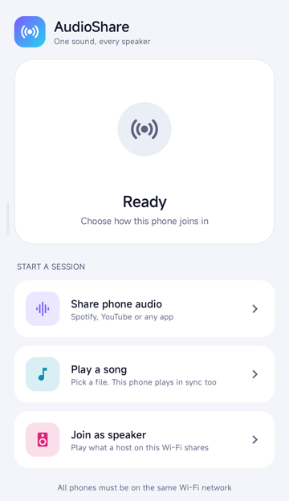
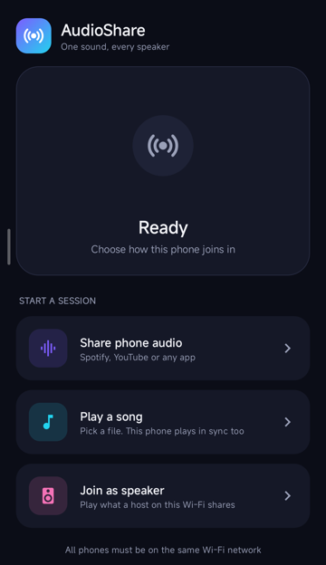
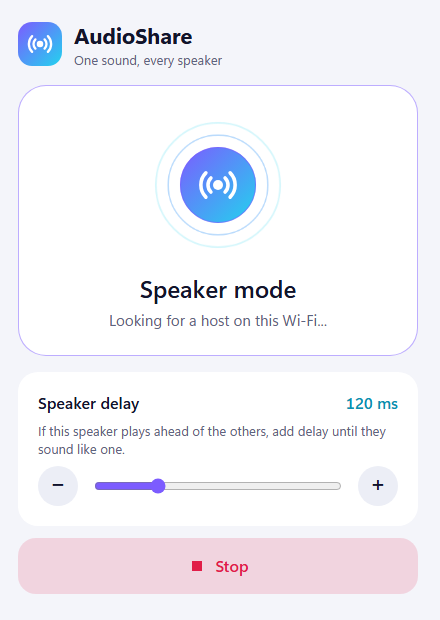

# AudioShare

**One sound, every speaker.** Play music from one phone or laptop through several phones, laptops and Bluetooth speakers at the same time, in sync.

Every device plays the same audio on a shared clock, so a room full of cheap speakers sounds like one big system. It works over home Wi-Fi or a phone hotspot, with no internet or account needed.

<p>
  
  
  
</p>

## Download

Get the latest files from the [**Releases**](../../releases/latest) page:

| File | For |
|---|---|
| `AudioShare.apk` | Android 10 or newer |
| `AudioShare.exe` | Windows 10 / 11 laptops and PCs |

## How to use it

1. Connect every device to the **same Wi-Fi**, or to one device's **hotspot**.
2. On each device that should play the music, open AudioShare and tap **Join as speaker**. Connect a Bluetooth speaker to it if you like.
3. On the device that has the music, pick one:
   - **Share phone audio** / **Share this PC's audio**: whatever plays on it (Spotify, YouTube, any app) goes to every speaker.
   - **Play a song** (phone only): pick an audio file. The host phone plays it too, in sync with the others.
4. If one speaker sounds a little ahead of the rest, move the **Speaker delay** slider on that device until they sound like one. Bluetooth speakers each add their own delay, so this is normal.

> The host's "Speakers connected" count shows who has joined.

## Installing

**Android:** open `AudioShare.apk` on the phone. If Android blocks it, allow "Install unknown apps" for the app you opened it from (Files, Chrome, WhatsApp…), then tap **Install**.

**Windows:** double-click `AudioShare.exe`. The first time:
- SmartScreen may say it's from an unknown publisher (the app isn't code-signed). Click **More info → Run anyway**.
- Windows Firewall will ask for network access. Allow **Private networks**, or other devices won't find the laptop.

## Good to know

- **Sharing phone audio** shows Android's "start recording or casting" prompt every time. Android requires it for privacy; AudioShare only captures sound, never the screen. Some apps (e.g. Netflix) block their audio from being captured.
- **When a laptop shares its audio**, its own speakers play about 0.25 s ahead of everyone else, because Windows can't delay its own output. Mute the laptop, or use other devices as the speakers.
- Audio is sent uncompressed (~1.5 Mbit/s per speaker). It's comfortable for a handful of speakers on normal Wi-Fi. A crowded network may stutter.

## How it works

The host timestamps every 5 ms of audio with the moment it should be heard (250 ms in the future, to absorb Wi-Fi jitter). Each speaker measures the difference between its own clock and the host's twice a second, NTP-style, and plays each packet at exactly that moment, adding silence or skipping ahead when it drifts more than 15 ms. Everything runs over UDP on the local network:

| Port | Message |
|---|---|
| 50006 | Host announces itself (broadcast, once a second) |
| 50005 | Speakers ping the host (clock sync + registration); host streams audio back |

The full protocol is documented at the top of [`Sync.kt`](app/src/main/java/com/audioshare/Sync.kt); the laptop app in [`desktop/`](desktop) speaks the same protocol.

## Building from source

**Android app:** open this folder in Android Studio and press **Run**, or build the APK with **Build → Build APK(s)**. Requires Android SDK 35.

**Windows app:** needs Python 3.

```powershell
cd desktop
pip install -r requirements.txt
python audioshare.py              # app window
python audioshare.py join         # terminal: play as a speaker (+/- adjusts delay)
python audioshare.py host         # terminal: share this PC's audio
python test_audioshare.py         # sync scheduler self-check
.\build.ps1                       # builds dist\AudioShare.exe
```
